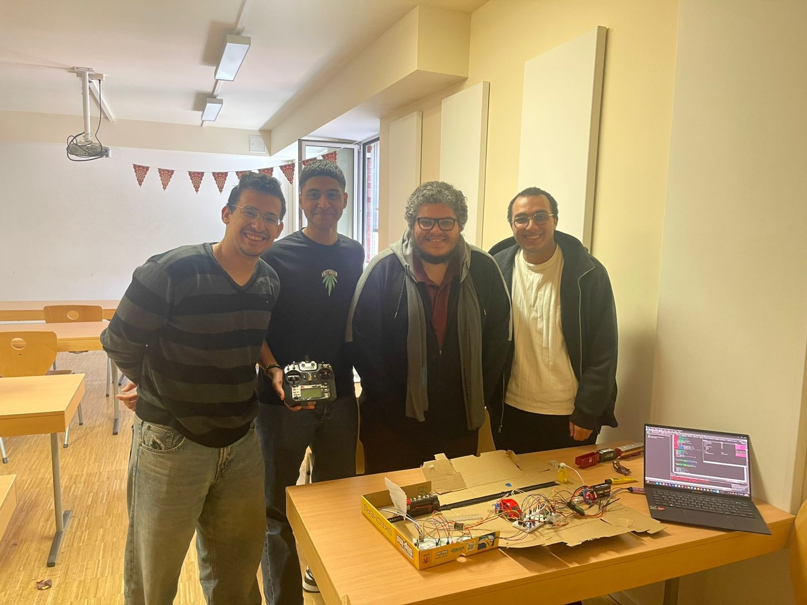
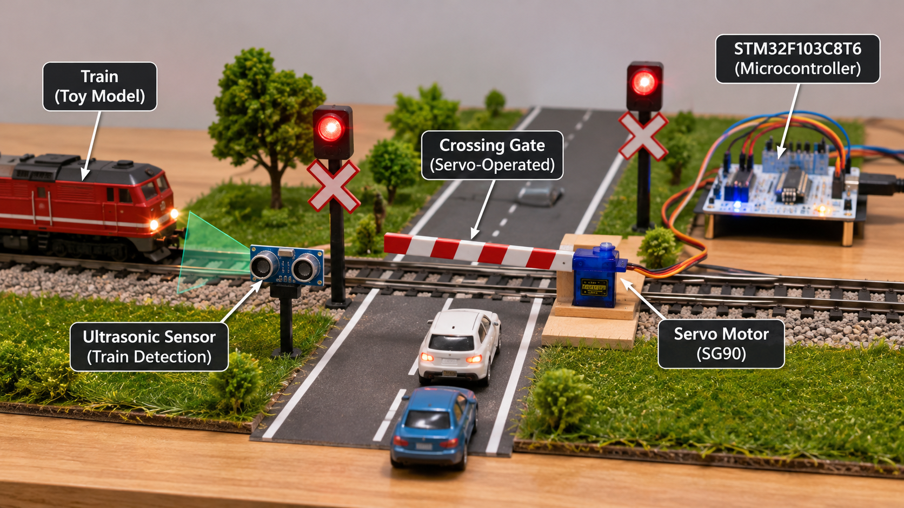

# STM32-Smart-Railway-Crossing
STM32-based smart railway crossing system featuring embedded C, automatic and manual control, ultrasonic sensing, PWM motor control, and a servo-operated gate.

**Embedded C | STM32F103C8T6 | Control Systems | Sensors | PWM**

## Project Overview
A university mechatronics team project developing a smart railway crossing demonstrator using an STM32F103C8T6 microcontroller.

The system integrates train propulsion, an ultrasonic distance sensor, a servo-operated railway gate, manual RC control, visual and audible indicators, and an emergency-stop function.

## Project Objectives
- Implement automatic and manual operating modes.
- Control train movement using PWM.
- Measure distance using an ultrasonic sensor.
- Coordinate railway gate movement with train position.
- Implement emergency-stop and reset functionality.
- Evaluate closed-loop train positioning.

## Hardware Components
- STM32F103C8T6 (Blue Pill)
- DC motor and motor driver
- Ultrasonic distance sensor
- Servo motor for railway gate
- RC receiver
- LEDs, buzzer, and pushbuttons

## Software and Control
**Programming:** Embedded C, STM32 peripheral registers

**Microcontroller peripherals:** GPIO, timers, PWM, input capture

**Automatic mode:** Ultrasonic distance feedback is used with a proportional (P) controller to adjust motor PWM toward a target stopping distance of 47 cm.

**Manual mode:** RC receiver inputs control the train motor and railway gate.

**Safety functionality:** Emergency-stop and reset buttons provide operator override.

## Reported Results
According to the project report:
- The demonstrator operated in automatic and manual modes.
- The train stopped near the target distance.
- The railway gate responded to the train's position.
- Distance filtering improved control reliability.
- Emergency-stop and reset functionality was evaluated.

## Technical Challenges
- Ultrasonic measurement fluctuations
- RC signal timing instability
- Servo jitter
- Button debouncing
- Motor response affected by friction and delay

## Project Documentation
[View the complete project report](Stm.pdf)

## Project Context
Mechatronics Engineering university team project, Spring 2025.

This repository currently contains the project report. Original source files and additional project materials may be added after verification and permission checks.

## Notes
The implemented feedback controller described in the report is proportional (P) control, rather than a complete PID controller.

## Project Gallery

### Actual Prototype and Project Team

*Our university team's physical railway crossing demonstrator.*

### Conceptual System Illustration

*AI-generated conceptual illustration, not a photograph of the actual hardware.*

